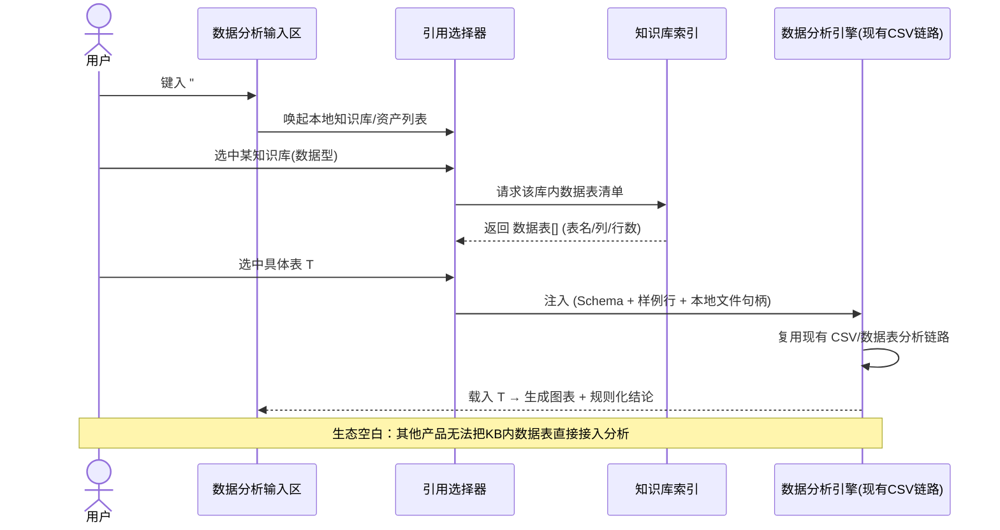

# 灵墨工作台「一键导入本地知识库」交互规格（轻量 PRD）

**文档版本**：v1.0（草案，作为架构设计输入）
**日期**：2026-09-02
**作者**：许清楚（产品）
**关联调研**：`deliverables/kb-competitor-research-2026-09-02.md`
**状态**：待架构评审

---

## 0. 文档定位

本文档是灵墨「知识库贯穿多生产力场景」能力的**交互规格 / 轻量 PRD**，不涉代码。输入来自竞品调研（范式 B + 生态空白结论）与灵墨现状对齐；输出对象为架构师（技术设计）、前端（交互实现）、测试（验收）。

与调研的对应关系：本规格的「范式 B 触发」「三层作用域」「双通道」「引用展示」分别对齐调研报告第 2、5 节；「数据型资产 + 数据分析独占点」对齐调研第 3 节「关键空白」。

---

## 1. 目标与范围

### 1.1 目标
让用户在灵墨**任一**生产力场景中，以**最低摩擦**（一次键入 `#` 或一次勾选）把「本地知识库 / 世界书」中的内容作为上下文注入当前任务，复用已有检索与引用能力；并**率先覆盖「知识库 → 数据分析 / 数据整理」这一全生态空白场景**。

### 1.2 覆盖范围（五场景）

| 场景 | 本规格中的优先级 | 复用现有能力 |
|---|---|---|
| 写作（长 / 短篇） | P1 | AI 写作上下文 + 引用 |
| 文案撰写 | P1 | AI 写作上下文 + 引用 |
| 笔记（Markdown + 标签 + 世界书） | P1 | 世界书全文注入 |
| 数据分析（CSV / 数据表 + 图表 + 结论） | **P0** | 现有 CSV / 数据表分析链路 |
| 数据整理（导入 / 清洗） | **P0** | 现有清洗 / 导入链路 |

### 1.3 优先级与理由
- **P0 = 数据分析 / 数据整理**：调研实证（Open WebUI 官方文档）全生态知识库**都不能**对库内 CSV 执行代码做聚合统计；RAGFlow 虽有 gVisor 代码沙箱，但「知识库 → 表格分析」是否一等公民场景未确认。此为灵墨**独占差异化点**，且灵墨已有 CSV / 数据表分析链路可直接复用 → 排 P0。
- **P1 = 写作 / 文案 / 笔记**：该价值已被 AnythingLLM、Open WebUI、Khoj 充分覆盖（红海），目标为「不比别人差 + 摩擦更低」→ 排 P1。
- **产品边界警示（来自调研）**：与灵墨形态几乎同构的 `reorproject/reor`（Electron + 本地 RAG + 笔记，8.5k ⭐）已于 2025-05 归档；说明「本地知识库 + 问答」本身不是卖点。知识库应定位为**贯穿六场景的底层供给层**，本规格即该定位的交互落地。

### 1.4 术语
- **知识库（KB）**：灵墨本地知识库流水线产出的可检索集合（向量索引）。
- **世界书（WorldBook）**：全文注入型上下文（精确、可控），对应范式 B 的「全文注入」通道。
- **资产（Asset）**：知识库 / 世界书中的最小可引用单元（一篇文档、一个数据表、一段世界书条目）。
- **引用（Citation）**：注入内容在生成结果中的来源归属标记。

---

## 2. 统一交互范式（范式 B 落地）

### 2.1 触发机制
- **主触发**：在任意支持文本输入的场景输入区键入 `#`，唤起「本地知识库 / 资产引用选择器」。
- **场景默认自动挂载**：若当前场景 / 项目已配置「场景默认知识库（见 2.2）」，进入该场景时自动以只读方式挂载，无需手动 `#`。
- **世界书快捷入口**：笔记场景额外提供「插入世界书」按钮，等价于对世界书资产走全文注入通道。

### 2.2 三层知识作用域

| 层级 | 定义 | 生效范围 | 存储位置（逻辑，具体路径待架构确认） | 生命周期 |
|---|---|---|---|---|
| **L1 场景默认知识库** | 用户为某场景全局设定的默认 KB | 该场景所有会话 | `userData/settings/sceneDefaultKB.json`（待定） | 长期，用户可改 |
| **L2 项目 / 文件夹知识库** | 绑定到具体项目或文件夹的 KB | 该项目下所有会话 | `userData/projects/<projectId>/meta.json` 的 `linkedKB[]` 字段（待定） | 随项目存在 |
| **L3 会话临时附加** | 本次会话临时挂载的 KB / 资产 | 仅当前会话 | 会话状态 `userData/.../sessions/<sessionId>.json` 或纯内存（待定） | 会话结束或显式移除 |

**存取规则**：L3 覆盖 L2 覆盖 L1（同资产冲突时，更具体的层级优先）。选择器顶部以三个分区呈现，用户可跨层多选。

### 2.3 双通道（全文注入 vs RAG 检索）

| 通道 | 对应机制 | 行为 | 默认适用 | UI 标识 |
|---|---|---|---|---|
| **全文注入（Full-text）** | 世界书 | 将资产完整内容（或用户选取片段）逐字注入上下文，无分块、无向量 | 世界书条目、小体积笔记 | 「全量」图标 |
| **RAG 检索（RAG）** | 知识库 | 分块向量化，按需取 Top-K chunk 注入 | 文档型 KB 资产 | 「检索」图标 |

- **用户自选**：引用选择器中每个资产带通道切换开关，默认按资产类型给出（文档型 → RAG，世界书 → 全文），允许覆盖。
- **区分呈现**：注入后在上下文区以不同底色 / 标签标明「全量注入」与「RAG 检索」，避免混淆。

### 2.4 引用选择器规格
- 唤起后展示：搜索框 + 三层分区列表（L1 / L2 / L3）+ 每个资产显示「类型图标（文档 / 数据 / 世界书）+ 名称 + 通道开关 + 上次引用时间」。
- 数据型资产（见第 3 节）在列表中有独立「数据表」子展开，可直接选到具体表。
- 支持多选、支持「仅本次会话（L3）」勾选。

---

## 3. 资产类型区分与注入策略

### 3.1 文档型资产（doc）
- 形态：Markdown / PDF / DOCX / TXT 等。
- 索引：进入知识库即分块向量化（沿用现有流水线）。
- 注入：RAG 通道取 Top-K chunk；或全文通道取整篇（小文档）。

### 3.2 数据型资产（data）—— 灵墨独占点
- 形态：CSV / XLSX。
- 结构化登记字段（索引时登记，**非**文本 chunk）：
  - `tableId` / `tableName`
  - `columnName[]` / `columnType[]`（推断值）
  - `rowCount`
  - `sampleRows`（前 N 行，用于让模型理解结构）
  - `localFilePath`（本地文件句柄，指向 userData 下原始文件）
  - `sourceAssetId`（所属 KB id）
- 索引时机：**待定**（见第 8 节：上传时自动识别并登记 vs 手动触发）。

### 3.3 注入策略对照表

| 场景 \ 资产类型 | 文档型 | 数据型 | 世界书 |
|---|---|---|---|
| 写作 / 文案 | RAG chunk（默认） | 不直接注入（除非作为样例引用） | 全文注入 |
| 笔记 | RAG 或全文 | 不直接注入 | 全文注入 |
| 数据分析 | （不适用） | **载入为数据表**（Schema + 样例行 + 句柄），非文本 | （不适用） |
| 数据整理 | （不适用） | **载入为待清洗数据表** | （不适用） |

> 关键点：数据型资产**不走文本通道**，而是「作为数据表加载进分析 / 整理引擎」，这是与 AnythingLLM / Open WebUI / Dify 等本质不同之处，也是本规格 P0 的核心。

---

## 4. 各场景交互流程

### 4.1 写作 / 4.2 文案撰写（P1，流程相同）
1. 在写作 / 文案输入区键入 `#` → 唤起选择器。
2. 选中文档型 KB 资产或世界书条目；通道默认（doc → RAG / 世界书 → 全文），可改。
3. 确认后，资产进入当前文档 AI 写作上下文；若 RAG，取 Top-K chunk。
4. 生成内容默认**显示引用来源**（见第 6 节），可一键关闭。
5. 世界书条目走全文注入，精确可控。

### 4.3 数据分析（P0）

**Mermaid 时序图**：

**步骤**：
1. 在数据分析场景输入区键入 `#` → 选择器。
2. 选中一个**数据型** KB 资产 → 选择器展开该库内**数据表列表**。
3. 用户选中具体表 T（可多选）。
4. 系统将 T 以「Schema + 样例行 + 本地文件句柄」注入数据分析引擎，**复用现有 CSV / 数据表分析链路**（不重新解析文本，直接对原表计算）。
5. 自动生成图表 + 规则化结论，与现有分析产物一致。
6. 该表作为 L3（或用户提升为 L2）挂载，本会话内可反复引用。

### 4.4 数据整理（P0）
- 流程同 4.3，但第 4 步载入的是**清洗 / 导入链路**而非分析链路：选中数据表 → 直接进入「导入 / 清洗」视图（去重、类型修正、缺失值处理等），复用现有数据整理能力。
- 强调：把知识库从「只能问答」扩展到「能清洗」，填补空白。

### 4.5 笔记（P1）
1. 在笔记编辑器键入 `#` 或用「插入世界书」按钮。
2. 选中 KB 资产（RAG / 全文）或世界书条目（全文）。
3. 选中内容注入当前笔记的 AI 上下文：RAG 取 chunk，世界书 / 小片段走全文。
4. 笔记侧栏显示「已挂载知识源」列表，可移除。

---

## 5. 数据 / 状态模型

### 5.1 引用记录字段（每次挂载一条）

| 字段 | 类型 | 说明 |
|---|---|---|
| `kbId` | string | 知识库 id |
| `assetId` | string | 资产 id |
| `assetType` | enum | `doc` / `data` / `worldbook` |
| `scope` | enum | `scene-default`(L1) / `project`(L2) / `session`(L3) |
| `channel` | enum | `full-text` / `rag` / `load-as-table` |
| `referencePosition` | string | 注入位置标识（文档 id / 会话 id / 笔记块 id） |
| `createdAt` | datetime | 挂载时间 |
| `tableRef` | string? | 数据型：选中的 `tableId`（仅 channel = load-as-table） |

### 5.2 存储位置（逻辑映射，具体路径待架构确认）
- 场景默认（L1）：`userData/settings/sceneDefaultKB.json`
- 项目绑定（L2）：`userData/projects/<projectId>/meta.json` → `linkedKB[]`
- 会话临时（L3）：`userData/projects/<projectId>/sessions/<sessionId>.json` 或内存态
- 数据型资产登记：随知识库索引存储（与现有 KB 索引同库），新增 `dataAssets[]` 子结构

### 5.3 与现有索引的关系
- **知识库索引**：现有向量索引增加「资产类型」维度；数据型资产不进向量，进**结构化登记表**（`dataAssets`）。
- **世界书索引**：全文注入直接读现有世界书条目，无需新索引；通道 = full-text。
- **既有 CSV 分析链路**：数据型资产载入时复用其解析 / 计算模块，仅入口从「文件上传」扩展为「知识库引用」。

---

## 6. 引用展示规范
- **默认开启 Citation**：所有经 RAG / 全文注入生成的内容，默认在结果中标注来源（KB 名 + 资产名 + 命中位置 / 块号）。
- **可关闭**：每个场景提供「显示来源」总开关（对齐 Dify 的 Citation and Attributions 可关设计）。
- **相关性分数（借 kotaemon）**：RAG 命中的 chunk 显示相关性分数；低于阈值时标记「低相关」样式。
- **低相关告警（借 kotaemon）**：当检索结果整体相关性偏低，在注入区提示「本次引用可能与问题相关性不足」，避免用户误信。
- **数据型资产**：引用展示为「已加载数据表 T（N 行 × M 列，来源 KB）」，而非文本引用。

---

## 7. 验收标准（可点测清单）
- [ ] **通用**：在写作 / 文案 / 笔记 / 数据分析 / 数据整理任一输入区键入 `#` 均能唤起选择器。
- [ ] **L1 / L2 / L3**：配置场景默认 KB 后进入场景自动挂载；项目绑定 KB 仅在该项目生效；会话临时挂载在会话结束后不残留于其他会话。
- [ ] **双通道**：文档型默认 RAG、可切全文；世界书默认全文；UI 以不同标签区分两类注入。
- [ ] **写作 / 文案**：引用 KB 生成内容默认显示来源，可关闭；世界书条目全文注入。
- [ ] **数据分析（P0）**：选中数据型 KB 资产 → 展开数据表列表 → 选表 → **直接进入现有分析链路**生成图表 + 结论；验证注入的是 Schema + 样例行 + 句柄而非文本 chunk。
- [ ] **数据整理（P0）**：选中数据表 → 进入清洗 / 导入视图，复用现有整理能力。
- [ ] **笔记**：`#` 或「插入世界书」可注入，侧栏显示已挂载源且可移除。
- [ ] **引用展示**：RAG 命中显示相关性分数；低相关有告警样式；数据表加载有来源条。
- [ ] **边界**：同时挂载多资产时上下文窗口超限有截断提示（策略见待定项）。

---

## 8. 未确认 / 待定项（需架构 / 前端确认，不臆造）
1. **知识库索引是否已区分 doc / data 两类资产**；数据型资产的**索引时机**（上传自动识别登记 vs 手动触发）—— 需架构确认现有流水线扩展点。
2. **userData 具体子路径**与现有项目 / 会话存储结构是否一致（本文路径为逻辑占位）。
3. **世界书与知识库在检索 / 存储层是否共享索引**，或各自独立 —— 影响 L2 跨层挂载实现。
4. **数据型资产登记最小字段集**需与现有数据分析场景 schema 对齐（列类型推断口径）。
5. **相关性分数阈值**与「低相关」判定口径（借 kotaemon 思路，具体数值待定）。
6. **多资产同时挂载的上下文窗口预算与截断策略**未确认。
7. **`#` 唤起在哪些具体输入控件可用**（富文本编辑器 / 纯文本框 / 表格单元格）—— 待前端确认；数据整理场景的触发入口可能非文本输入框，需另定。
8. **数据型资产「载入为表」与现有 CSV 解析模块的接口契约**未定（句柄传递方式）。

---

## 9. 给架构 / 工程的前置输入（一句话）
本规格定义了「触发 — 作用域 — 通道 — 资产类型 — 注入策略 — 引用展示」六要素，建议架构师据此输出：① 引用记录的数据模型与 userData 落库方案；② KB 索引增加 `assetType` 维度与 `dataAssets` 结构化登记的改造点；③ 数据型资产 → 分析 / 整理引擎的句柄传递接口；④ `#` 触发在前端各输入控件的统一接入层。
